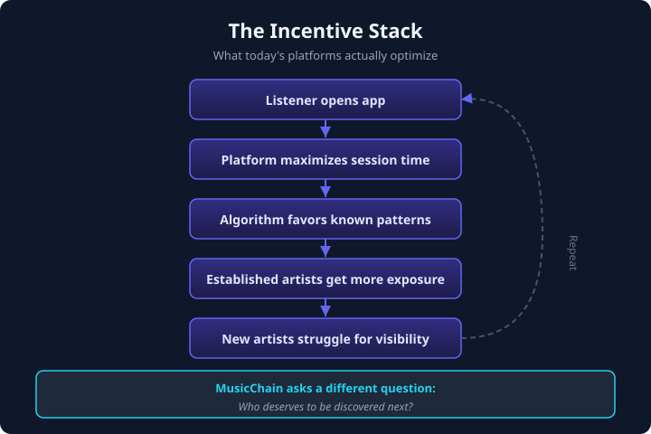

# Chapter 1 — The State of Music

> *Part I — Why*

---

## Today's music ecosystem

Modern streaming platforms have transformed how music is distributed and consumed. They provide unprecedented access to millions of tracks, enabling listeners to enjoy music from around the world almost instantly. For the first time in history, a teenager in São Paulo, a producer in Lagos, and a jazz enthusiast in Tokyo share the same theoretical library.

This is a genuine achievement. Distribution — the problem of *getting music to people* — has been largely solved.

But distribution is not discovery.

---

## The optimization problem

Streaming platforms are businesses. Like all businesses, they optimize for measurable outcomes: subscriber retention, session length, ad revenue, catalog licensing efficiency. Recommendation systems learn from past behavior because past behavior is observable, quantifiable, and correlates with those outcomes.

This creates a predictable dynamic:

| What platforms optimize for | What listeners experience |
|----------------------------|---------------------------|
| Engagement and retention | Familiar playlists, repeated artists |
| Catalog efficiency | Major-label back catalogs |
| Session length | Comfort music, not surprise |
| Existing engagement signals | Rich-get-richer visibility |

For listeners, exploration narrows over time. The algorithm learns what you already like and serves more of it. Discovery becomes a side effect, not the objective.

For emerging creators, visibility becomes the bottleneck — not talent, not quality, not originality. An extraordinary song uploaded today competes against decades of established catalog, pre-existing engagement data, and editorial playlists shaped by industry relationships.

This dynamic is not the result of bad intentions. It is a consequence of optimization. Systems optimized primarily for engagement tend to amplify content that is already performing well.

---

## The incentive stack

Understanding MusicChain requires understanding what today's platforms are *actually* optimizing. Not their marketing language — their mechanics.



```
Listener opens app
        ↓
Platform maximizes session time
        ↓
Algorithm favors known engagement patterns
        ↓
Established artists receive more exposure
        ↓
New artists struggle for visibility
        ↓
Listeners hear less diverse music
        ↓
Platform retains subscribers through familiarity
        ↓
Repeat
```

Every step is rational for the platform. None of it is designed to answer: *Who deserves to be discovered next?*

---

## What the internet solved — and what it didn't

The internet solved **distribution**. Any artist can upload. Any listener can stream. Geographic barriers collapsed. Gatekeepers lost their monopoly on physical shelf space.

The internet did **not** solve **discovery**. If anything, the abundance of content made discovery harder. When there are ten thousand new songs per day, "available everywhere" is not the same as "found by the right person."

> **The internet solved distribution. It did not solve discovery.**

That sentence is the foundation of everything that follows.

---

## A complementary objective

MusicChain does not claim to replace streaming platforms or invalidate their model. Convenience, catalog depth, and playback quality matter. Listeners will always want a reliable way to play music they already know.

MusicChain seeks to complement this landscape by optimizing for a different objective:

> **Helping listeners discover new artists through authentic engagement, transparent reputation, and community participation.**

Where Spotify asks *"What do you already like?"*, MusicChain asks *"What will you love next?"*

That subtle difference changes the product category entirely. One is a music player. The other is an exploration platform.

---

## The three stakeholders

Every music ecosystem has three participants whose incentives must align:

```
        Listener
           ↓
        Artist
           ↓
        Platform
           ↓
        Listener
```

When any one stakeholder wins at the expense of the others, the system degrades. Listeners become passive consumers. Artists become content suppliers. The platform becomes an intermediary extracting value from both.

MusicChain designs for a different equilibrium: **nobody wins alone. Everybody contributes. Everybody grows.**

The next chapters explain how.

---

*Continue to [Chapter 2 — The Discovery Problem](./02-discovery-problem.md)*
