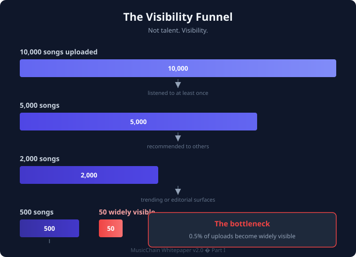

# Chapter 2 — The Discovery Problem

> *Part I — Why*

---

## The visibility funnel

Consider what happens to music on a typical platform today.



```
10,000 songs uploaded
██████████████████████████████

        ↓ listened to at least once

5,000 songs
███████████████

        ↓ recommended to others

2,000 songs
██████

        ↓ appear in trending or editorial surfaces

500 songs
██

        ↓ become widely visible

50 songs
█
```

One tiny bar at the bottom.

That is the bottleneck.

Not talent. Not quality. Not effort.

**Visibility.**

---

## The discovery gap

The gap between "uploaded" and "discovered" is where most music lives and dies. Artists invest hours, days, or years into a track. It enters a system where visibility is a function of existing popularity. Without initial exposure, there is no engagement signal. Without engagement signal, there is no recommendation. Without recommendation, there is no exposure.

It is a closed loop that favors incumbents.

For listeners, the mirror image is equally frustrating. The music that would resonate most deeply — the artist whose style matches your taste but whose name you have never heard — remains invisible. Not because it doesn't exist. Because the system never introduced you.

---

## Why algorithms alone fail discovery

Recommendation algorithms are pattern-matching engines. They excel at:

- Predicting what you will replay
- Grouping similar listeners
- Surfacing content with strong historical engagement

They struggle with:

- Artists who have no engagement history yet
- Genres outside your established listening pattern
- Genuine novelty (by definition, the unknown has no training data)

An algorithm optimized for retention will always bias toward the familiar. That is not a bug in the algorithm. It is the objective function.

Discovery requires a different objective.

---

## Authentic discovery vs. manufactured engagement

Not all "discovery" is equal.

| Type | Example | Value |
|------|---------|-------|
| **Authentic discovery** | Listener finds an unknown artist, listens deeply, returns later | High — real relationship formed |
| **Manufactured engagement** | Click farm, bot plays, paid playlist placement | Zero or negative — erodes trust |
| **Passive exposure** | Song autoplays in background, skipped in 3 seconds | Low — no meaningful connection |
| **Social discovery** | Friend shares an artist they genuinely love | High — trust transfer from peer |

MusicChain is designed to reward **authentic discovery** — the kind where a listener and an artist form a real connection. Every mechanism in this whitepaper serves that distinction.

---

## The North Star Metric

If MusicChain measured success the way most platforms do — registered users, daily active users, total streams — it would eventually optimize for the same outcomes as everyone else.

Instead, MusicChain proposes a different primary metric:

### Successful discoveries per day

**Definition:** A listener finds a new artist they had never heard before and:

- listens for at least *X* minutes (deep engagement), **or**
- saves the artist or track, **or**
- follows the artist, **or**
- returns to them within a defined window (sustained interest)

Normative event schema: **[MCIP-0009](../../../musicchain-specifications/mcip/MCIP-0009-successful-discovery.md)** (Draft).

This metric aligns everyone's incentives:

| Stakeholder | Incentive |
|-------------|-----------|
| **Listeners** | Become explorers, not passive consumers |
| **Artists** | Receive genuine exposure, not empty clicks |
| **Platform** | Rewards real engagement instead of vanity metrics |
| **Community** | Discovery becomes a shared, measurable activity |

When the platform optimizes for successful discoveries, every feature decision has a clear test: *Does this help someone find music they would genuinely love?*

---

## What discovery looks like on MusicChain

Discovery on MusicChain is not a single moment. It is a pipeline:

```
Artist uploads
      ↓
Early listeners discover (First 100)
      ↓
TFPS observes field pressure
      ↓
Community votes and engages
      ↓
Discovery Score rises
      ↓
Recommendations expand to similar explorers
      ↓
Artist grows authentic audience
      ↓
Community rewarded (XP, reputation, resources)
      ↓
Repeat
```

Each stage is designed, measured, and rewarded. Nothing is left to opaque algorithmic fate.

---

## The question that changes everything

Most platforms answer:

> *"What do you already like?"*

MusicChain answers:

> *"What will you love next?"*

The next chapter introduces the single principle that makes this answer operational — not just aspirational.

---

*Continue to [Chapter 3 — The Music Discovery Law](./03-music-discovery-law.md)*
