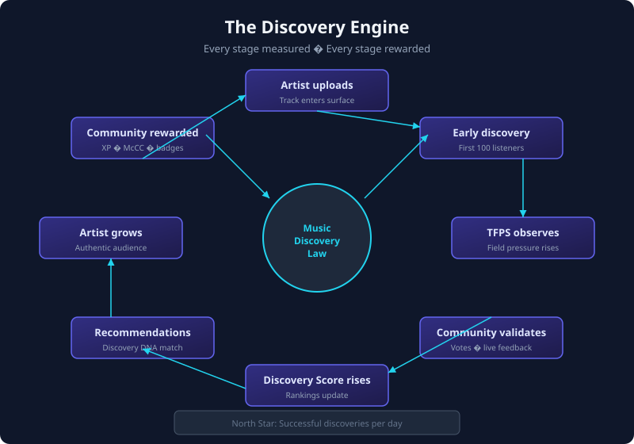

# Chapter 10 — Discovery Engine

> *Part III — The Engine*

---

## Purpose

The discovery engine is the operational heart of MusicChain — the closed loop that turns **uploads** into **authentic audiences** without optimizing for passive replay.

Every stage produces **observable events** that feed TFPS, UserChain, rewards, and recommendations. Nothing depends on a black-box “engagement score.”

This chapter describes the engine at the product level. Normative event rules for the North Star metric are in **[MCIP-0009](../../../musicchain-specifications/mcip/MCIP-0009-successful-discovery.md)**.

---

## The discovery loop



```
Artist uploads
      ↓
Early listeners discover (First 100 — planned)
      ↓
Listen triad commits → TFPS observes field pressure
      ↓
Community votes / live feedback (planned surfaces)
      ↓
Discovery Score rises (profile + artist metrics)
      ↓
Recommendations expand to similar explorers (Discovery DNA — planned)
      ↓
Artist grows authentic audience
      ↓
Community rewarded (XP, McCC, Fuel, reputation)
      ↓
Repeat
```

Each arrow must satisfy the [Music Discovery Law](../part-i/03-music-discovery-law.md): authentic participation that increases the probability the next great artist is discovered.

---

## Layered truth: Event → Meaning → Memory → Identity

MusicChain does not write discovery outcomes directly into UI counters. The pipeline is:

```
Listen / interact (Event)
      ↓
Listen triad + interactions (Meaning)
      ↓
TFPS day buckets + soul reducer (Memory)
      ↓
Track soul, rankings, profiles (Identity)
```

The listen triad module documents this explicitly:

> *Event → Meaning → Memory → Identity*  
> *listen_triad is the single source of truth per play commit:*  
> *commit_blockchain → notify_creator → feed_tfps → feed_fragments*

Reference (private monorepo): `musicchain/core/listen_triad.py`, `docs/triad_soul_architecture.md`.

---

## Stage 1 — Artist upload

A track enters the engine with **zero engagement history**. At this moment:

- TFPS is dormant or emerging ([heat bands](./11-tfps.md)).
- The artist has no Discovery Score.
- Recommendations must rely on **explorer behavior**, community rooms, and TFPS rise — not popularity priors.

Upload is necessary but not sufficient; the engine starts when **listeners commit authentic playtime**.

---

## Stage 2 — Listen triad (single play commit)

Each qualifying listen produces one **`ListenTriadEvent`** bound by a unique `event_id`:

| Field | Role |
|-------|------|
| `listener_id` | Who discovered / listened |
| `track_id` / `creator_id` | What was heard |
| `seconds` | Depth of listen |
| `activist` / `creator` / `bridge` legs | McCC, Fuel, Gas splits |
| `stabilizer` | Triad closure quality |

One commit fans out to:

1. **Blockchain / track block** (bridge leg — auditable history)
2. **Creator notification** (activist/creator messages)
3. **TFPS** (`triad_commits` in daily event vectors)
4. **Soul reducer** (fragments, ritual density over 13-day memory)

This is why TFPS and chain integrity stay aligned: they share the **same event_id**.

---

## Stage 3 — TFPS signal collection

Daily buckets aggregate plays, likes, boosts, comments, follows, downloads, and **triad_commits** into `TrackDayEvents`. TFPS computes bounded pressures `P_current`, `P_resonance`, `P_final` plus heat and momentum labels.

See [Chapter 11 — TFPS](./11-tfps.md) for formulas and UI mapping.

TFPS answers: *Is this track gaining authentic momentum?* It does not alone answer *Did this listener successfully discover a new artist?* — that is [MCIP-0009](../../../musicchain-specifications/mcip/MCIP-0009-successful-discovery.md).

---

## Stage 4 — Community validation

Structured signals (planned product surfaces; partially live today):

| Signal | Source |
|--------|--------|
| Live **Breakout / Needs Work** votes | Live sessions |
| Discovery Party 👍❤️🔥👎 | Community rooms |
| Prediction game picks | Weekly pools |
| Reports | Trust-weighted moderation |

Trust-weighted votes feed TFPS velocity and **thermo-combo** ranking (Live-313 terminal), not raw click counts.

---

## Stage 5 — Discovery Score (artist + listener)

**Listener** Discovery Score components are in [Chapter 5](../part-ii/05-the-listener.md) (Explorer Level, Hidden Gems, Legendary Finds).

**Artist** Discovery Score combines TFPS rise, supporter growth, authenticity gates, and successful-discovery attribution (listeners who MCIP-0009-classify as “new artist” listens).

Scores are **transparent aggregates** over events — not undisclosed ML ranks.

---

## Stage 6 — Recommendation expansion

Target behavior (Discovery Intelligence — [Chapter 8](../part-ii/08-the-ai.md)):

> *People with your Discovery DNA found these artists.*

Inputs:

- Explorer-weighted genre/scene vector (not replay-only history)
- TFPS emerging/resonating tracks
- Trust-weighted community picks

AI may **propose** candidates; humans **decide** via listen, save, follow. The engine measures outcomes via successful discoveries per day.

---

## Stage 7 — Rewards

Reward engine (Layer 5) applies tier tables to triad legs. TFPS **modulates** resources via `apply_pressure_to_resources` — higher field pressure increases McCC multiplier and adjusts Fuel/Gas thermodynamically (deterministic, bounded).

Rewards for **discovery actions** (first listen to new artist, referral qualified discovery, mission completion) extend base tables via future MCIPs — always subordinate to anti-abuse and trust gates.

---

## North Star instrumentation

**Successful discoveries per day** is the primary product metric ([Part I, Ch. 2](../part-i/02-discovery-problem.md)).

Implementation:

| Piece | Status |
|-------|--------|
| MCIP-0009 event definition | Draft spec (normative) |
| `successful_discovery` event store row | Implemented (`musicchain/models/discovery_store.py`) |
| Projector + listen/save/follow hooks | Implemented (`musicchain/core/discovery_events.py`) |
| Analytics / admin dashboard | Planned |
| Referral payout on qualified discovery | Planned ([Growth Engine](../part-vi/growth-engine-v1-spec.md) Ph. 1) |

---

## Anti-patterns the engine rejects

| Pattern | Why |
|---------|-----|
| Bot streams without triad integrity | Pollutes TFPS; trust decay |
| Referral bonus on signup only | Empty growth; violates Growth Engine v1.0 |
| Pay-for-play Rising 100 | Violates Authenticity over Virality |
| Opaque recommendation without explainability | Violates Transparency |

---

## Reference implementation map

| Concern | Location (private monorepo) |
|---------|----------------------------|
| Listen triad | `musicchain/core/listen_triad.py` |
| TFPS | `musicchain/core/track_field_pressure.py` |
| Day event loader | `musicchain/core/track_field_pressure_loader.py` |
| Soul / TFPS reducer | `musicchain/core/track_soul_reducer.py` |
| Live-313 ranking | `musicchain/core/thermo_combo.py` |
| TFPS UI | `templates/partials/tfps_metrics.html`, track blockchain views |
| Determinism tests | `scripts/test_field_pressure.py` |

Public validation rules: MCIP-0006 (chain), MCIP-0009 (discovery events).

---

## Summary

The discovery engine is not a recommendation widget bolted onto streaming. It is a **replayable pipeline** from listen triad → TFPS → reputation → rewards → expanded exploration — governed by the Music Discovery Law and measured by **successful discoveries per day**.

---

*Previous: [Chapter 9 — The Chain](../part-ii/09-the-chain.md) · Next: [Chapter 11 — TFPS](./11-tfps.md)*
